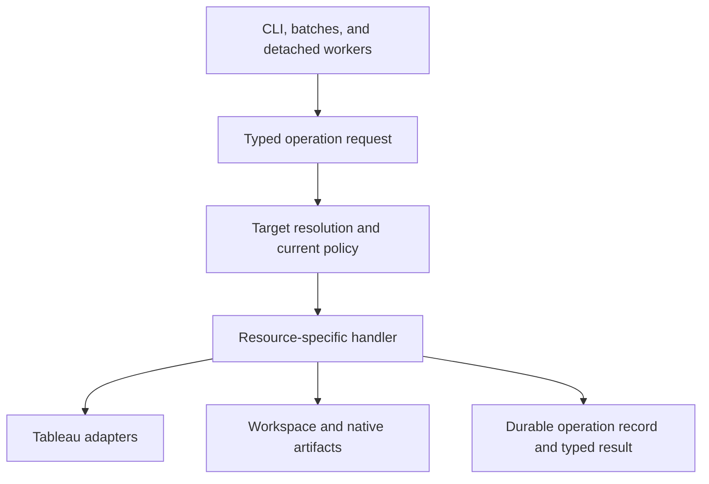

# Potential TADX architecture improvements

**Status: Ideas for reference only.**
**No implementation is planned or authorized.**

This document preserves a discussion about a hypothetical TADX rewrite and the changes considered most worthwhile for the current product.
It records recommendations, constraints, and relative priorities without establishing a roadmap or implementation plan.
The source observations come from the original discussion and do not establish confirmed runtime defects.

## Existing strengths

The proposed direction centers on typed operations, portable workspace definitions, and durable records of changes.
The current architecture already provides foundations worth preserving:

- One Go binary with resource-oriented actions and explicit resource behavior.
- Exact Tableau identities and site-specific consent for remote mutations.
- Native credential storage and protection of credentials throughout execution.
- A clear boundary with Tableau MCP, which owns data queries, view data and images, and Pulse values and insights.
- Existing plans, durable execution records, and recovery mechanisms that support incremental improvements.

TADX commands continue to own content lifecycle, artifacts, workspaces, administration, and Pulse definition lifecycle.
They do not call or proxy Tableau MCP.

## Architectural proposals

### Typed operations as the internal API

Current batches reconstruct Cobra commands, while detached workers save arguments and re-enter the CLI.
Command syntax therefore participates in the execution architecture.
The relevant sources are [batch handling](../internal/cli/batch.go) and [worker requests](../internal/app/publication_worker.go).

The proposal introduces versioned, typed operation requests that commands, batches, and workers invoke directly.
Each operation owns its inputs, constraints, effects, and result schema.
The existing capability registry could generate machine-readable schemas and relevant help from these contracts.
Resource handlers retain explicit behavior for publication, permissions, Pulse, and other operations.

The expected benefit is consistent execution across interactive commands, automation, and background workers.
The operation boundary provides shared contracts without introducing a generic workflow runner that hides resource-specific behavior.

### Authorization at the operation boundary

Current enforcement partly depends on wrappers around Cobra callbacks.
The proposal requires a resolved execution context containing the canonical server, exact site, authenticated identity, and applicable policy.
Every remote operation passes through this boundary, including worker execution.
Fresh checks remain wherever permissions, files, or remote state can change.

This proposal strengthens an architectural guarantee; it does not imply a current authorization bypass.
Saved plans and previews remain separate from permission to write.
Persisted site consent and all other applicable policy checks still govern consequential mutations.

The expected benefit is that another execution entry point cannot omit safeguards attached only to CLI plumbing.
Combined with typed operations, this boundary unifies input validation, target selection, policy enforcement, and execution.

### A durable lifecycle for consequential operations

TADX already has publication plans, detached workers, operation records, and accepted Tableau job receipts.
The proposal connects these into one coherent operation record.
That record distinguishes intended changes, resolved targets, accepted remote work, confirmed effects, verification results, and remaining uncertainty.

For example, publication could report: "Tableau accepted the workbook; metadata verification remains incomplete."
Recovery could continue observation against that known identity.
An uncertain submission must never trigger automatic resubmission.

Where useful, persisted plans could bind reviewable changes to artifact fingerprints and exact targets.
Applying a saved plan still requires revalidation.
Persistence could extend to other consequential operations where interrupted execution creates meaningful uncertainty.
Recovery resumes observation or verified remaining work while preserving confirmed identities and effects.

The expected benefit is inspectable, recoverable interrupted work with fewer decisions left to agents interpreting error prose.

### Portable workspace definitions and destination bindings

The current workspace manifest primarily identifies the workspace, while artifacts carry richer source provenance.
The relevant source is [workspace configuration](../internal/workspace/manager.go).

The proposal adds stable logical artifact IDs, explicitly selected dependencies, desired metadata, and environment-specific bindings to authoritative Tableau LUIDs.
Source provenance remains separate from destination identity.
These definitions could support a bounded request to promote a workbook and selected datasources, show missing mappings, and apply supported changes.

Pulse already provides useful datasource-mapping behavior to build upon.
Native workbook promotion requires verified rebinding support.
Tableau's publishing API does not automatically package workbook dependencies; see the [Tableau publishing reference](https://help.tableau.com/current/api/rest_api/en-us/REST/rest_api_ref_publishing.htm).

The expected benefit is repeatable, reviewable promotion across environments.
Omission from a manifest never implies deletion.
General deployment planning depends on evidence for dependency rebinding, especially for native workbooks.

### Semantic inspection alongside native artifacts

Fingerprints establish that bytes changed.
Users also need to understand whether connections, calculations, dependencies, or supported settings changed.

The proposal introduces versioned semantic projections for meaningful diffs and comparisons among original, local, and current remote content.
Native bytes and opaque sections remain intact.
A partial projection cannot establish complete equivalence.
Transformations remain limited to supported, validated structures.

Pulse provides a useful starting point because authoring intent and portable bundles could share one editable configuration model.
Read-only dependency and connection diffs provide another bounded direction.
Broad workbook equivalence or rewriting requires substantially stronger format evidence.

The expected benefit is that agents can explain changes and detect conflicts before publication.

### Addressable results and structured follow-up actions

Current expansion hints can refer to a replaceable `last-result.json`.
Concurrent agents or intervening commands can change what "last" means.
The relevant source is [saved-result handling](../internal/app/last_result.go).

The proposal gives retained results immutable IDs, bounded retention, and schema versions.
Expansion commands reference those IDs, while `last` remains a convenience.
Typed follow-up actions contain the operation, arguments, and target context.
Paste-ready commands render from those records.

Results also expose source, freshness, completeness, and uncertainty where relevant.
Tableau metadata can hide or omit permission-restricted information, so an empty result cannot universally prove absence.
See the [Tableau Metadata API permissions documentation](https://help.tableau.com/current/api/metadata_api/en-us/docs/meta_api_permissions.html).

The expected benefit is reliable retrieval of exact evidence and continuation of work across commands and sessions.
Structured follow-up actions preserve arguments and target context without requiring agents to reconstruct them from prose.

## Conceptual execution structure

The following diagram captures the proposed relationship between entry points, operation contracts, resource handlers, and execution records.
It describes a hypothetical architecture, not the current implementation.

## Shortlist for the current product

The discussion identified three especially worthwhile changes and two directions with narrower conditions.
These priorities express relative value, not a delivery sequence or commitment.

| Relative priority | Potential change | Rationale and boundaries |
| --- | --- | --- |
| Highest | Typed operation requests with integrated authorization | Unify validation, target selection, policy enforcement, and execution across commands, batches, and workers. |
| High | Immutable result IDs and structured follow-up actions | Preserve exact evidence, arguments, and target context when agents or commands run concurrently. |
| High | Coherent durable operation history | Connect existing plans, worker records, and Tableau receipts to clarify partial completion and recovery. |
| Conditional | Portable workspace definitions | Reconsider when reliable cross-environment promotion becomes a product priority, with verified dependency rebinding. |
| Narrow supported scope | Semantic artifact inspection | Focus on Pulse configuration and read-only dependency or connection diffs, with broader work contingent on format evidence. |

The highest-value architectural candidate combines typed operations with authorization at the execution boundary.
This combination addresses a shared dependency across batching, workers, and recovery.
Immutable result IDs provide independent value and do not require that migration to finish first.

## Hypothetical incremental adoption

A complete rewrite is unnecessary for these improvements.
Current resource boundaries, safety rules, and durable execution mechanisms provide a base for incremental adoption if separately authorized.

If typed operations were pursued, workbook publication would provide a representative first scope.
It exercises individual commands, batches, previews, workers, and recovery.
The contract could then extend to operations with the same needs while resource-specific execution remains explicit.

Immutable result IDs could proceed independently, retaining `last` as a convenience and adding structured follow-up actions and explicit result-schema versions.
Durable history could connect existing publication records before extending to other consequential operations with meaningful interruption uncertainty.

Portable workspaces would begin with explicit artifact and destination bindings if promotion became a priority.
Semantic inspection would begin with specific supported structures and preserve native artifacts throughout.

These possibilities remain recorded ideas only.
This document authorizes no implementation, migration, or product behavior change.
