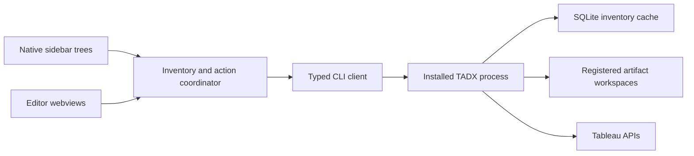

# TADX extension implementation plan

The VS Code extension lives in `extensions/vscode` in the TADX repository.
It has an independent package, version, build, test suite, and VSIX artifact.
Keeping both products together makes changes to the CLI output contract reviewable with their consumers.
The extension consumes the installed CLI through explicit argument arrays and JSON output.
TADX retains ownership of Tableau access, credentials, cache persistence, workspace protection, and mutation policy.
The [editor architecture guide](architecture/editor-extension.md) describes the implemented owners, state, failure paths, and current limitations.
This plan records accepted scope; the architecture guide owns the current-system explanation.

## Agreed experience

- Native sidebar trees show every configured site, registered local workspaces, and operation activity.
- Sites expand independently, and project folders retain their parent-child hierarchy.
- Artifact details open in an editor webview with actions for an exact selected artifact.
- A **Bulk Actions** editor supports mixed-type bulk download and upload to one destination.
- Site and project selection use native Quick Picks with full project paths.
- The extension previews upload and download requests before starting the operation.
- Cache freshness, incomplete inventory, unavailable workspaces, and operation failures remain visible.
- Local baseline cleanliness does not imply equality with the current remote artifact.

The extension does not implement Transfer View, synchronization, dependency migration, or a general interface for every TADX command.
Native tree headers use toolbar commands instead of the mockup's embedded form controls.
VS Code owns placement and resizing of the surrounding views.

## Architecture

The CLI client validates external JSON, preserves operation errors and partial outcomes, and runs without a shell.
The coordinator owns selected identities, request validation, refresh sequencing, and operation state.
Webviews receive display projections and send bounded intent messages with opaque artifact keys.
Messages never supply commands, executable paths, or arbitrary filesystem locations.
Native Quick Picks select explicit environment aliases, workspace names, and project LUIDs.
The extension never changes saved mutation consent or credentials.

Browser-only and virtual workspaces are outside the first release.
Remote development runs the extension beside the workspace, so the CLI, configuration, cache, and credentials belong to that host.
Workspace Trust gates process execution.

## Implementation sequence

1. Define and test the CLI boundary against real output contracts and failure shapes.
2. Add cache-backed site inventory and registered workspace inventory without remote fallback.
3. Build native navigation and accessible, themed editor views.
4. Connect explicit previews, download and upload actions, and durable operation receipts.
5. Add source provenance only where the CLI has authoritative evidence.
6. Validate unit contracts, extension-host activation, packaging, and representative user flows with isolated fixtures.

## Operation guarantees

Bulk actions use one source context and at most 100 selected artifacts across workbooks, datasources, and flows.
Downloads choose one workspace; uploads choose one destination environment and project.
The extension previews all resource groups before one confirmation, then submits the CLI's resource-specific batches and retains their individual receipts.
An immediate submission failure or cancellation stops remaining groups without implying rollback of accepted work.
Upload uses exact local artifact paths, a selected destination environment, a project LUID, and an explicit create or overwrite mode.
Changing a destination or conflict mode requires a new preview.
The CLI revalidates when the operation runs; a preview is not an authorization token.
Create collisions remain failures until the user explicitly chooses another destination or overwrite.
Background operations retain their operation IDs and expose status checks.
Cancellation or transport failure never implies rollback or permission to retry.

## Validation and delivery

Focused tests cover argument construction, malformed output, process bounds, identity validation, and partial failure evidence.
UI tests cover selection, message validation, escaping, and the native extension host.
Fixtures use synthetic identities and no live credentials or Tableau mutations.
Package validation produces an installable VSIX without publishing it.
Existing repository changes remain outside this build's scope.
The build does not authorize a push, pull request, Marketplace publication, or release.

## Build outcome

The accepted extension scope is implemented in `extensions/vscode`.
The [validation record](vscode-extension-validation.md) lists completed checks, review corrections, and acceptance limits.
The [extension guide](../extensions/vscode/README.md) provides installation and development commands.
