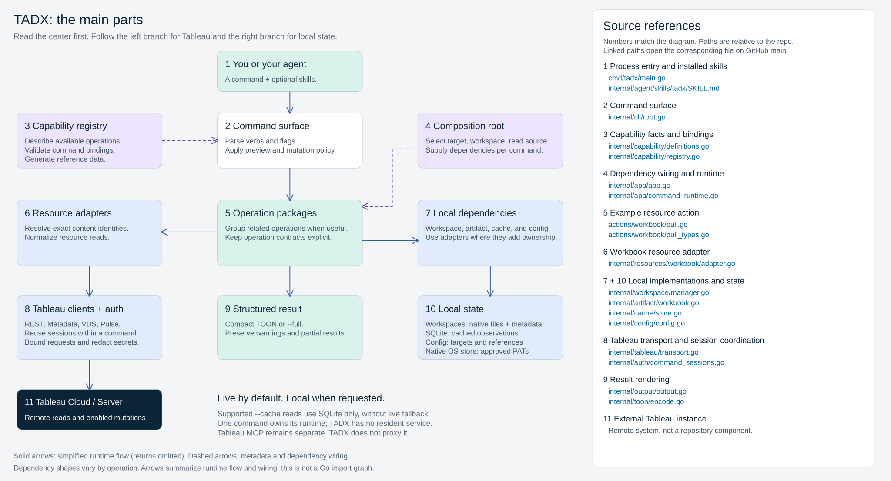

# TADX architecture

TADX is a Go CLI for Tableau lifecycle operations, local artifacts, administration, upstream metadata, and Pulse configuration.
It builds one executable and creates a runtime for each invocation.
Supported transfers can run in a detached instance of the same executable; no resident service is required.
Tableau MCP remains a separate integration for analytical queries, rendered views, and Pulse values and insights.
The separately packaged VS Code extension consumes the CLI to present inventory and selected artifact operations.

The documentation below describes the implemented source architecture.
Each guide links directly to its implementation owners and states the limits of its coverage.

## Read the architecture

Follow this path for a first contribution:

1. Read the [package reference](../repository-structure.md) for ownership and permitted dependencies.
2. Read [command runtime and recovery](runtime.md) for startup, policy, authentication, workers, results, and failure behavior.
3. Read [resources and state](resources-and-state.md) for operation families, API boundaries, identifiers, artifacts, and cache semantics.
4. Read [dependencies and delivery](dependencies-and-delivery.md) for libraries, external tools, embedded Guidance, generated files, installation, and release gates.
5. Read [editor extension architecture](editor-extension.md) for the VS Code host, CLI contract, inventory, previews, and retained operation references.
6. Use [CONTRIBUTING.md](../../CONTRIBUTING.md) for local setup and validation, then follow the guidance for your named implementation task.

Each page links to implementation owners and representative tests.
The guides use architecture-level traces across distinct operation families; they do not claim line-by-line correctness review of every command.

## Understand the main boundaries

| Responsibility | Owner | Required distinction |
| --- | --- | --- |
| Process startup and dependency composition | `cmd/tadx`, `internal/app` | Wiring selects concrete dependencies; it does not replace resource-specific operation rules. |
| Command interface | `internal/cli` | Cobra parses and dispatches; executable help owns public syntax. |
| Operation contracts and outcomes | `actions` resource and service packages | Operations retain distinct validation, side effects, and partial results. |
| Remote selection and normalization | `internal/resources` | REST LUIDs are authoritative; ambiguous selectors fail. |
| Remote requests | `internal/tableau`, `internal/auth` | Provider clients own API mechanics; transport retry advice does not authorize repeating a mutation. |
| Local state | Workspace, artifact, cache, configuration, operation, and job stores | Each store has a different identity, lifetime, authority, and recovery contract. |
| Results and discovery | `internal/output`, `internal/toon`, `internal/capability` | Expanded detail and encoding do not change acquisition bounds or authorize operations. |
| Editor integration | `extensions/vscode` | The extension consumes public CLI contracts; TADX retains credentials, remote access, persistence, and mutation enforcement. |

See [runtime guards](runtime.md#execution-guards-and-wrapper-order) for the relationship between managed policy, site consent, and Tableau authorization.
See [resources and state](resources-and-state.md) before treating cached observations, Metadata IDs, artifacts, or retained results as interchangeable.
The [security model](../security.md) owns security guarantees and their limits.

## Find the right change location

| Goal | Start with |
| --- | --- |
| Trace a user operation or explain a failure | [Runtime and recovery](runtime.md), then the relevant [resource trace](resources-and-state.md) |
| Add or change a lifecycle operation | Existing resource action, adapter, provider, CLI binding, and composition examples in the [implementation map](../../.agents/skills/tadx-build/references/implementation-map.md) |
| Change source selection or discovery | [Search source map](search.md) and [cache behavior](resources-and-state.md) |
| Change artifact or workspace behavior | [Workspace guide](../workspaces.md), `internal/artifact`, and `internal/workspace` |
| Change configuration, authentication, or permission enforcement | [Runtime](runtime.md), [security](../security.md), and [managed policy](../managed-policy.md) |
| Change help or public command layout | [Command structure](../command-structure.md) and actual Cobra definitions |
| Change output, partial failure, or recovery commands | [Output contract](../toon.md), `internal/errs`, and runtime result handling |
| Change capability ownership or generated references | [Capability metadata](../repository-structure.md#capability-metadata-and-documentation) and its generator |
| Change embedded Guidance, installation, updates, or releases | [Dependencies and delivery](dependencies-and-delivery.md) |
| Change editor inventory, previews, or operation recovery | [Editor extension](editor-extension.md), then the [extension contributor guide](../../extensions/vscode/README.md) |

Repository-wide agent rules live in [AGENTS.md](../../AGENTS.md).
The build skill owns task-specific implementation procedures and applies only when explicitly requested for a named build task.
Installed operating Guidance under `internal/agent/skills` serves a different audience: agents using the released CLI.

## Use the visual overview

The diagram summarizes CLI command handling, operation rules, remote integrations, local state, and rendering.
The [editor architecture](editor-extension.md#components-and-dependencies) provides the extension's separate component map.

Open [the editable Excalidraw diagram](tadx-architecture.excalidraw) in Excalidraw to zoom, edit, or follow the numbered source links.
The side legend points to concrete files rather than listing every command inside the boxes.
Solid arrows summarize runtime flow; dashed arrows show registry and dependency wiring.
Action packages group related operations where their ownership and behavior match.
Their dependencies use focused interfaces, direct calls, or shared services according to each package's contract.

The [search source map](search.md) traces native search, additional REST/Pulse inventories, cache search, and catalog metadata search.
The [capability map](../reference/capability-map.html) answers a different question: which operations TADX provides.
The [runtime guide](runtime.md) traces workbook pull through foreground observation and detached recovery.
Open the SVG directly to zoom, or use the editable Excalidraw file to follow its source annotations.

## Maintain the documentation

Keep package ownership in the package reference, shared execution guarantees in the runtime guide, and domain differences in the resource guide.
Update links and agent entry points when moving an authoritative explanation.
Keep proposed changes explicitly labeled and separate from implemented behavior.
Regenerate capability references through their generator and preserve existing human-authored evidence and decisions.
Recheck affected call paths and tests when source behavior changes; this guide does not replace implementation review.
