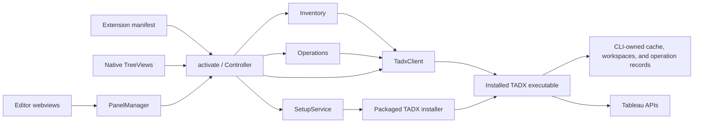

# VS Code extension architecture

The extension presents cached site inventory, registered workspaces, and selected artifact operations through the public TADX CLI.
It lives in `extensions/vscode` and produces a separately versioned VSIX.
The CLI owns credentials, Tableau requests, cache persistence, artifact mutations, policy enforcement, and durable operation records.

The [extension guide](../../extensions/vscode/README.md) owns setup, supported actions, and development commands.
The [implementation plan](../vscode-extension-plan.md) records accepted scope.
The [review record](review.md) separates current behavior from proposed repairs and identifies the examined working tree.

## Components and dependencies

The diagram's owners and relationships are defined here:

| Owner | Responsibility and evidence |
| --- | --- |
| [Manifest](../../extensions/vscode/package.json) and [`activate`](../../extensions/vscode/src/extension.ts) | Register views, commands, settings, host requirements, and trust requirements; construct the controller. |
| [`Controller`](../../extensions/vscode/src/controller.ts) | Bind commands, gather native Quick Pick inputs, resolve selected identities, coordinate previews, and invoke host file or browser actions. |
| [`InventoryTree` and `ActivityTree`](../../extensions/vscode/src/trees.ts) | Project inventory and operation state into native sidebar items; return selections to controller commands. |
| [`PanelManager`](../../extensions/vscode/src/panels.ts) and [webview script](../../extensions/vscode/media/panels.js) | Manage editor panels, project state, render text, and validate bounded intent messages against host-owned rows. |
| [`Inventory`](../../extensions/vscode/src/inventory.ts) | Own selected sources, loaded inventories, refresh generations, filtering, errors, and display projections. |
| [`Operations`](../../extensions/vscode/src/operations.ts) | Snapshot requests, coordinate preview and confirmation, classify results, retain receipts, and inspect operations manually. |
| [`TadxClient` and `runCommand`](../../extensions/vscode/src/cli.ts) | Construct explicit argument arrays, parse operation-specific JSON, preserve error documents, and bound subprocess lifetime and output. |
| [`CLI compatibility`](../../extensions/vscode/src/compatibility.ts) | Evaluate advertised implementation, preview, and batch contracts before launching affected commands. |
| [`SetupService`](../../extensions/vscode/src/setup.ts) and packaged installers | Prepare immutable installation plans, verify executable ownership and freshness, and invoke maintained installers with exact release and archive pins. |
| [CLI runtime](runtime.md) and [resource owners](resources-and-state.md) | Enforce current policy, resolve exact targets, manage local persistence, and perform resource-specific operations. |

The extension does not link Go packages, open SQLite, parse private configuration, or call Tableau APIs directly.
There is no resident bridge service or shell command interpreter.
`runCommand` uses `spawn` with `shell: false` and appends `--full --json` through `TadxClient.run`.

## Host and selection boundaries

The manifest selects a workspace extension host and excludes untrusted and virtual workspaces.
Activation and controller commands also check Workspace Trust.
On remote development hosts, the executable, user configuration, cache, workspaces, and credential access belong to that host.
The extension has no browser-only entry point.

The controller reads the executable path and timeout from VS Code settings at construction.
Setting changes request a window reload.
It does not pass a custom configuration path; the CLI uses its normal host-user configuration selection.
See [setup snapshots and fresh state](runtime.md#setup-snapshots-and-fresh-state) for CLI precedence.

Activation and **Reload Inventory** read the CLI version and complete capability metadata.
Compatibility depends on required command behavior rather than a blanket minimum version; compatible older and development CLIs remain usable.
The client checks each command against the current compatibility report before launch and preserves usable commands when others are unavailable.
Saved site consent and managed policy remain separate execution restrictions.
Inventory readers validate required operation fields, and version/capability discovery validates its metadata.
Generic mutation replies must be JSON objects; `Operations.operationState` interprets their status rather than applying a complete operation-specific schema.

`Inventory.refresh` preserves the bulk editor's selected environment if it remains configured.
Otherwise, it selects the CLI default or the sole configured environment.
Opening **Bulk Actions** without either choice selects and loads the first configured environment; this does not change CLI configuration.
Workspace selection preserves the previous choice, then uses the CLI default or an available valid workspace.
The extension lists registered TADX workspaces, including those outside open editor folders.
It does not register editor folders automatically or change saved CLI defaults.

Remote row keys combine environment alias, resource kind, and LUID.
Local row keys combine workspace name, kind, and artifact path, falling back to the reported identity.
These are UI selection keys, not durable source identities or authorization tokens.
`Controller.selection` resolves keys against loaded inventory before constructing requests.

## Inventory reads and freshness

`TadxClient.siteInventory` starts five independent CLI reads: cache status and cached project, workbook, datasource, and flow lists.
It uses `--cache --all` for content lists and never substitutes a live read when cached inventory fails.
One failed resource read can leave other resource lists visible with an explicit incomplete-inventory warning.
Display warnings come from the four requested lists, including their `source.cache_warning` metadata, rather than the cache-wide status warning collection.
The cache model retains global coverage and warnings, including permission coverage, without presenting unrelated scopes as artifact inventory failures.
Malformed required fields produce a contract error instead of an empty successful inventory.
Environment and workspace discovery reject truncated lists; artifact lists retain their partial-coverage indicators.

The native site tree displays every configured environment as a collapsed root and loads that site's inventory when expanded.
Projects retain their parent-child hierarchy, with short folder names and full-path tooltips.
Filtering preserves ancestors of matching content; missing parents and cyclic hierarchy evidence remain visible without recursive tree cycles.
Expanding a site does not change CLI configuration or hide other sites.
Registered workspaces load on selection or expansion.
Local kinds outside workbook, datasource, and flow remain visible but have no transfer actions.

`Inventory.refresh` cancels superseded requests and rejects late results from older extension refresh generations.
Ordinary loads of one source share its current in-flight promise.
Forced source reloads start a new read and cancel the previous read for that source.
Only the latest source read in the current global refresh generation can publish inventory or errors, including when an older client ignores cancellation.
Disposal invalidates pending completions.
That mechanism does not pin the separate CLI reads to one SQLite generation.
`siteInventory` retains resource generation metadata but does not compare generation IDs before combining results.
Concurrent cache refresh can therefore produce mixed observations without a consistency warning.
The [review finding](review.md#preserve-cache-generation-evidence-in-combined-inventory) records the evidence and proposed boundary.

**Reload Inventory** reads cache and workspace state.
**Refresh Site Cache** explicitly runs `cache refresh` for projects, workbooks, datasources, and flows, then reloads the selected site.
Remote changes do not trigger automatic cache refreshes.
List bounds and incomplete coverage remain distinct from the webview's 100-row display pages.

## Operation traces

| Family | Request and success path | Denial, failure, and recovery |
| --- | --- | --- |
| Download | Resolve selected cached LUIDs; choose a registered workspace and options; preview; confirm; invoke pull with `--no-wait`. | CLI guards protect local changes and exact targets. Accepted work retains an operation ID. Cancellation does not roll back accepted work. |
| Upload | Resolve exact local paths; choose environment, project LUID, and conflict mode; inspect consent; preview; confirm; publish with `--no-wait`. | Disabled consent or a reported restriction takes the read-only preview path. Execution rechecks CLI policy and current target state. |
| Local move or delete | Resolve one managed artifact; select destination or acknowledge dirty deletion; preview; confirm; invoke the foreground CLI operation. | CLI filesystem and dirty-state guards remain authoritative. Successful actions reload affected workspace inventories. |
| Status inspection | Select a retained operation ID; invoke `job inspect --operation-id`; display the retained snapshot; reload inventories after recognized success or partial completion. | Successful inspection retains a saved failure for the exact requested operation. Genuine inspection errors retain the prior ID; see the [resolved review finding](review.md#distinguish-status-inspection-from-the-saved-operation-outcome). |
| Open or reveal | Resolve a local path through `workspaceFile`, or validate an authoritative remote URL through `tableauUrl`; invoke the VS Code host action. | Missing paths, traversal, resolved paths outside the workspace, and foreign-origin URLs fail before the host action. |

[`Inventory.transferSelection`](../../extensions/vscode/src/inventory.ts) requires 1 to 100 unique transferable rows from one source.
Selections can mix workbooks, datasources, and flows.
The controller captures one destination workspace for download or one environment and project for upload.
`Operations` groups the immutable selection into the CLI's resource-specific requests, previews all groups, and obtains one confirmation.
Each submitted group retains its own operation ID and result in Activity.
Immediate failure, unknown outcomes, or cancellation stop remaining submissions and identify unsubmitted groups; accepted workers continue independently.
Upload destinations use exact project IDs; displayed project paths help selection but do not authorize a write.
`Operations` copies request values before previewing, so later selection changes cannot mutate that request.
The confirmation is nonmodal so the operation preview remains readable.
Moving backward through destination selection creates a new request before previewing.

Preview success does not authorize execution.
The CLI revalidates policy, saved site consent, filesystem state, and resource-specific conditions when the operation runs.
The extension never changes consent or stores PATs.
It does not migrate dependencies, credentials, schedules, or cross-site references during upload.

## Guided CLI setup

**CLI Status and Setup** exposes executable selection, installation, and update or repair through native pickers and confirmations.
The controller owns those interactions; `SetupService` owns the captured setup plan and bounded installer process.
The service classifies a regular executable at the canonical shared user location as managed; it does not consult installation receipts or package-manager ownership.
Preview rejects other paths, linked executables, development builds, and versions newer than the selected release.
Choosing a compatible existing executable remains available.

[`cli-release.json`](../../extensions/vscode/cli-release.json) supplies an exact verified release and archive SHA-256 for the workspace host platform.
The build copies the maintained shell and PowerShell installers into the package.
Those installers own GitHub downloads, manifest and independent pin verification, installation locking, replacement, and bundled Guidance installation.
The extension does not implement a second archive extraction or binary replacement path.

Confirmation names the destination, version, Guidance changes, and optional PATH or completion changes.
The captured executable fingerprint and resolved destination are checked again before the installer starts.
The immutable plan retains the fingerprint verified with the inspected version, or an explicit absence requirement for a new installation.
The installer checks that requirement after acquiring its replacement lock and before changing the executable or Guidance.
A changed target rejects the installation and requires a new preview.
An explicit acknowledgment covers other TADX commands and detached transfers because the extension cannot prove host-wide inactivity.
The controller serializes interactive operations, and `TadxClient.withMaintenance` excludes this client's active and new CLI invocations during installation.
The service filters inherited environment variables, limits time and output, and never claims confirmed rollback after interruption or failed verification.
After successful setup, the controller checks CLI compatibility before saving the executable setting.
See the [release and upgrade guide](../vscode-extension-release.md) for current policy, delivery, and platform verification limits.

## State, errors, and cleanup

| State | Owner and lifetime |
| --- | --- |
| Selected environment and workspace | VS Code `workspaceState`; restored and checked against current discovery. |
| Loaded inventories, errors, and filter | `Inventory` memory; refreshed explicitly and discarded on host shutdown. |
| Panel navigation and selection | Webview `getState` and `setState`; source, query, type, sort, page, and selected row keys, without inventory or operation documents. |
| Preview request | One `Operations.perform` invocation; copied before preview and discarded after confirmation, cancellation, or failure. |
| Activity results | At most 100 in-memory entries; preserve available JSON documents and partial outcomes. |
| Accepted operation references | At most 100 IDs, titles, and timestamps in `workspaceState`; restored with unknown status until inspected. |
| Durable progress and recovery evidence | CLI operation and job stores; see [runtime recovery](runtime.md). |

No full operation result or inventory is persisted by the extension across reloads.
The retained extension receipt is a reference to CLI-owned evidence, not a second operation journal.
`Operations.restore` validates receipt fields and does not resume or resubmit work.
There is no automatic status polling or write retry.

`runCommand` bounds combined stdout and stderr and applies a timeout and cancellation signal.
Stopping that subprocess does not prove a detached worker or remote request stopped.
Timeout, cancellation, output truncation, and malformed responses during execution produce an unknown outcome.
`TadxError` retains a parsed document when available; `Operations.perform` keeps accepted identities from error envelopes.
An unacknowledged CLI worker launch is displayed as unknown, with its receipt and recovery warning preserved.
Explicit unknown effects retain confirmed item evidence; a confirmed rejection remains failed.
Ordinary errors reach the native notification and output channel.

Controller disposal releases panels, subscriptions, views, and current inventory or operation cancellation controllers.
The status-inspection path does not pass a cancellation signal to the client; its subprocess remains bounded by the configured timeout.
Neither disposal nor cancellation removes CLI journals or accepted remote work.

## Trust boundaries and identity limits

[`validatePanelRequest`](../../extensions/vscode/src/panels.ts) validates action kinds, known sources, known row keys, allowed row actions, and bounded batch selections.
The controller independently resolves those keys and builds arguments from host-owned records.
Webview messages do not supply executable paths, shell text, arbitrary file paths, or destination LUIDs.
Webview HTML uses a nonce-based content security policy and restricts local resources to packaged media.
The webview script renders inventory strings with DOM text APIs.

[`workspaceFile`](../../extensions/vscode/src/paths.ts) checks relative path syntax, resolves real paths, and verifies containment before opening or revealing a file.
This is a point-in-time host-action check; CLI mutation guards own consequential filesystem operations.
`tableauUrl` accepts only HTTP or HTTPS URLs without embedded credentials and with the configured server origin.
Browser actions require a CLI-provided URL; the extension does not invent URLs from LUIDs.

Local cleanliness compares the artifact with its acquired baseline, not current remote content.
Full workspace output can include validated source server and site identity from [`workspace.status`](../../actions/workspace/status.go).
Cached remote inventory lacks the authoritative site identity required for verified remote/local correlation.
The extension displays provenance without equating matching names or LUIDs across sites.

## Change placement and verification

Change public CLI parsing in `cli.ts`, display models in `model.ts`, inventory state in `inventory.ts`, and preview or receipt handling in `operations.ts`.
Keep VS Code inputs and commands in `controller.ts`; keep native tree projection in `trees.ts` and editor rendering in `panels.ts` and `media`.
Extend CLI action, adapter, and output owners when a feature requires new authoritative facts or operation guarantees.
Do not add direct cache or Tableau access to bypass a missing public contract.

For a new remote inventory field, trace the resource's list output rather than assuming its inspect output supplies the editor.
For workbooks, that path includes [`ListOutput.FullOutput`](../../actions/workbook/list_types.go), [`Record`](../../actions/workbook/workbook.go), and live normalization through [`workbookListReader`](../../internal/app/workbook_inventory.go).
Also inspect [`cacheWorkbookListReader`](../../internal/app/cache_reads.go) and the [REST cache collectors](../../internal/tableau/cache/collectors.go) so cache refresh retains the field.
Then update `RemoteArtifact`, `TadxClient.siteInventory`, `Inventory.snapshot`, and the applicable native or webview projection.
Use CLI list/cache fixtures, [`cli.test.ts`](../../extensions/vscode/tests/cli.test.ts), [`inventory.test.ts`](../../extensions/vscode/tests/inventory.test.ts), and browser fixtures for the changed path.
Handwritten JSON fixtures do not establish real CLI compatibility.
The [source CLI runner](../../extensions/vscode/scripts/test-cli.mjs) and [pinned-release runner](../../extensions/vscode/scripts/test-release-cli.mjs) consume actual CLI read contracts in isolated local fixtures.
They complement synthetic host and parser tests without establishing live Tableau transfer behavior.

The [contributor commands](../../extensions/vscode/README.md#develop-and-validate) cover type checking, lint, unit tests, browser scenarios, extension-host fixtures, and VSIX packaging.
The [build validation record](../vscode-extension-validation.md) records earlier Windows checks and live-site and remote-host limits.
The [delivery guide](dependencies-and-delivery.md#editor-integration) explains the separate package and release boundary.
The original architecture refresh used source traces and synthetic probes; the [review](review.md) records its later compatibility and delivery resolutions separately.
